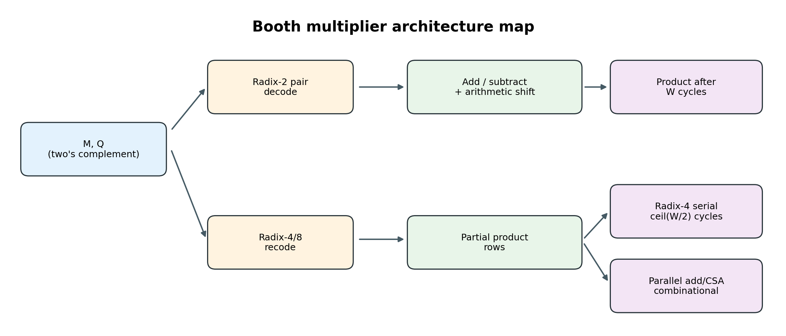

# Booth 编码与有符号乘法器：从位级推导到波形

这个工程是一套可运行的教学材料。读者可以先推导 `13 × (-7)`，再运行八种有符号 Booth 架构及无符号封装，最后从实际 VCD 波形检查每一步。RTL 不用 `*` 实现 Booth；`*` 只在对照模块和 testbench 中作为独立参考。



## 30 秒运行

环境：Icarus Verilog (`iverilog`、`vvp`)；lint 另需 Verilator；生成图片与波形报告另需 Python 3 和 `matplotlib`。形式验证和通用综合另需 Yosys。

```bash
bash scripts/run.sh
bash scripts/lint.sh
python3 scripts/vcd_report.py
python3 scripts/make_figures.py
python3 scripts/recode.py 8 13 -7
```

验证综合与形式检查时继续运行：

```bash
bash scripts/formal_check.sh
bash scripts/formal_check.sh --deep
bash scripts/formal_check.sh --induct-r2-w8
python3 scripts/synth_compare.py
python3 scripts/plot_synth.py --width 16
python3 -m pip install -r requirements-video.txt
python3 scripts/make_video.py  # macOS：在线女声配音与 MP4
python3 scripts/package.py
```

`run.sh` 对位宽 2、3、4、5、6、7、8、9、12、16、24、31、32 运行有符号与无符号等价测试，并生成 `build/trace_13x-7.vcd`。位宽 2–7 穷举全部输入对，较大位宽执行边界用例和 500 对随机输入；W=9 和 W=31 特别检查较宽的奇数位。它还检查迭代接口与流水线吞吐。`lint.sh` 用 Verilator 对九个 RTL 入口与六种代表位宽做 54 次参数展开检查，并检查 12 个测试/形式验证顶层。`vcd_report.py` 从真实 VCD 提取时钟周期表和 PNG 波形。`build/` 是可再生输出，不纳入源文件。

`recode.py` 独立打印 radix-2/4/8 每组编码、数字和部分积，可用来核对手算；它只需 Python 标准库。
`package.py` 在工程上级目录生成 UTF-8 文件名的完整 ZIP，包含源码、教材、原论文扫描件、图片、视频及关键验证证据。
VS Code 工程设置见 `.vscode/settings.json`：编辑器使用 Verilator 并搜索 `rtl/`。若 HDL 文件标红，先运行 `bash scripts/lint.sh` 查看可复现的诊断；本机 Digital IDE 插件的 macOS 后端缺失情况见 [STATUS.md](STATUS.md)。

## 视频讲解

[观看约七分四十六秒中文 MP4（VS Code 兼容版）](video/Booth编码原理与硬件实现_晓晓女声有声版_VSCode兼容版.mp4)；[保留的原版视频](video/Booth编码原理与硬件实现_晓晓女声有声版.mp4)；[单独播放音频](video/Booth编码讲解音频.m4a)；[阅读完整讲解词](video/讲解词.md)。视频依次讲原论文、相邻位重编码、`13 × (−7)`、radix-2 RTL、真实 VCD 波形、radix-4/8/CSA/流水线和替代边界。兼容版将原版稀疏的视频帧转为 24 fps 恒定帧率 H.264，并将配音转为 MP3 立体声，以适配 VS Code 的视频预览。画面和旁白由 `python3 scripts/make_video.py` 在 macOS 上复现；默认使用 `zh-CN-XiaoxiaoNeural`、语速 `-8%`，需要联网、Python 3、`requirements-video.txt` 中的依赖及系统 `swift`/`afconvert`。离线可加 `--engine mac` 使用系统语音。在线配音通过 [edge-tts 项目](https://github.com/rany2/edge-tts)调用 Edge 语音服务；[微软语音目录](https://learn.microsoft.com/en-us/azure/ai-services/Speech-Service/language-support)列出该中文女声。

## 建议的学习顺序

1. [原论文精读](docs/08_原论文精读.md)：读五页扫描原文，对照相邻位规则与现代 RTL，分清原文和后续扩展。
2. [原理与手算](docs/01_原理与手算.md)：两补码、radix-2、radix-4、radix-8 的推导和编码表。
3. [硬件架构与 RTL](docs/02_硬件架构与RTL.md)：逐个模块理解寄存器、组合通路、CSA 和时序接口。
4. [仿真与波形](docs/03_仿真与波形.md)：读测试平台、VCD、周期表及问题排查。
5. [优势、应用与替代边界](docs/04_优势应用与替代.md)：功能等价的条件、性能权衡及应用场景。
6. [自测练习](docs/05_练习.md)：先自己推，再用工程核对。
7. [综合与形式验证](docs/06_综合与形式验证.md)：同流程的通用门统计、SAT 证明及结论边界。
8. [练习解答与验证思路](docs/07_练习解答与验证思路.md)：逐拍状态、部分积、CSA 与归纳证明的详细核对。

## 代码地图

| 文件 | 角色 | 时序 |
| --- | --- | --- |
| `rtl/booth_radix2_iter.v` | 经典 Booth：`A/Q/Q-1` 加减与算术右移 | `WIDTH` 个 busy 周期 |
| `rtl/booth_radix4_iter.v` | 每周期累加一行 modified Booth 部分积 | `ceil(WIDTH/2)` 个 busy 周期 |
| `rtl/booth_radix8_iter.v` | 每周期累加一行 radix-8 部分积，共用译码器与累加器 | `ceil(WIDTH/3)` 个 busy 周期 |
| `rtl/booth_radix4_parallel.v` | 所有 radix-4 行并行产生，线性加法链 | 组合 |
| `rtl/booth_radix4_csa.v` | radix-4 行经 3:2 carry-save 压缩，最后一次进位传播加法 | 组合 |
| `rtl/booth_radix8_parallel.v` | radix-8 重编码，含 `3M` 生成，线性加法链 | 组合 |
| `rtl/booth_radix8_csa.v` | 同样的 radix-8 部分积，改用 CSA 压缩 | 组合 |
| `rtl/booth_radix4_pipe.v` | radix-4 部分积寄存后经 CSA 与输出寄存 | 每拍可接收一组 |
| `rtl/booth_radix4_unsigned.v` | 无符号输入零扩展后复用有符号 radix-4 CSA | 组合 |
| `rtl/mul_inferred.v` | `*` 推断乘法器，作功能对照 | 组合 |
| `tb/tb_equivalence.sv` | 边界、穷举、随机等价检查 | 仿真 |
| `tb/tb_unsigned.sv` | 无符号穷举、边界与随机检查 | 仿真 |
| `tb/tb_control.sv` | 忙时启动、完成脉冲、结果保持、复位取消与重启 | 仿真 |
| `tb/tb_pipeline.sv` | 背靠背输入、空拍、吞吐与复位冲刷流水 | 仿真 |
| `tb/tb_trace.sv` | 输出可追踪的 VCD 与文字轨迹 | 仿真 |

## 当前验证结论

在 `WIDTH=2,3,4,5,6,7,8,9,12,16,24,31,32` 下，八个有符号 Booth 实现与 `*` 对照和 testbench 数学乘积一致；无符号封装也通过对应位宽测试。组合架构在 W=4 和 W=8 另有 SAT 等价证明；迭代和流水架构在 W=4、5 有任意控制输入的有限步数据与控制证明，在 W=8 通过组合等价加时序记分板归纳证明了任意后续控制序列下的乘积和控制关系。W=32 的控制接口另有归纳证明，数据则由仿真覆盖。证明边界及复现命令见第六章。这里的“一致”要求相同输入宽度和符号解释、输出保留完整 `2*WIDTH` 位。功能等价不能推出各种架构的面积、最高频率或功耗谁更好；那些指标需要同一目标工艺/FPGA、综合约束和实现流程再测量。

## 外部参考

- [A. D. Booth, *A Signed Binary Multiplication Technique* (1951)](https://www.ece.ucdavis.edu/~bbaas/281/papers/Booth.1951.pdf)：原始有符号乘法方法；本地扫描件与逐页解读见[第八章](docs/08_原论文精读.md)。
- [MIT 6.175 Lab 3: Multipliers](https://csg.csail.mit.edu/6.175/labs/lab3-multipliers.html)：教学中的 Booth 与 radix-4 讨论。
- [B. Parhami, Computer Arithmetic: Multiplication](https://web.ece.ucsb.edu/Faculty/Parhami/pres_folder/f31-book-arith-pres-pt3.pdf)：modified Booth、carry-save 与高 radix 的课程讲义。

## 工程进度

原理、八个有符号 Booth RTL、无符号封装、对照模块、等价仿真、VCD 解析、图片与讲解已可运行。通用门综合与 SAT 验证已加入第六章。工程进度、检查结果和接续入口记录在 [STATUS.md](STATUS.md)。PPA 评价还需目标器件/工艺、约束、综合与布局布线结果；工程不把理论行数当作硅面积或实测时延。
