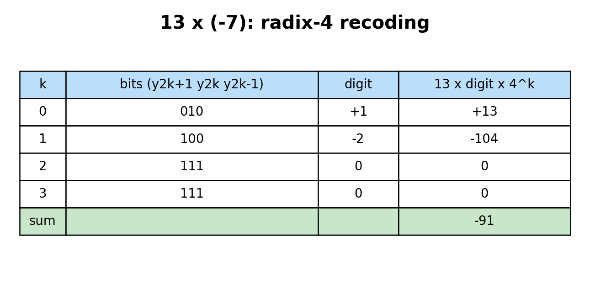

# 01 原理与手算

## 1. 先明确我们在乘什么

`WIDTH=W` 的输入是 **W 位两补码有符号整数**。最高位为 1 时，其权重是 `-2^(W-1)`。例如 8 位的 `1111_1001₂ = 249 - 256 = -7`。输出为 `2W` 位，保留完整乘积；以 `13 × (-7)` 为例，16 位结果是 `1111_1111_1010_0101₂ = 0xFFA5 = -91`。

普通逐位乘法把乘数写成若干 `0/1` 位，每位产生 `0` 或 `M<<i`，再相加。有符号数的符号位需要负权重或校正。Booth 重新表示的是**乘数**：把连续的 1 编成在区间边缘的加/减事件；得到的和仍是同一个整数。原论文的目标正是让正、负数用统一过程相乘。[原论文扫描件与逐页分析](08_原论文精读.md)

## 2. radix-2 Booth：观察相邻两位

设乘数位为 `q_(W-1)...q_0`，额外定义 `q_-1=0`。第 `i` 位的 Booth 数字为：

```text
d_i = q_(i-1) - q_i                d_i ∈ {-1, 0, +1}
Q   = Σ [d_i × 2^i], i=0..W-1    Q 按 W 位两补码解释
M×Q = Σ [d_i × M × 2^i]
```

| 当前位 `q_i`、前一位 `q_(i-1)` | `d_i` | 动作 |
| --- | ---: | --- |
| `00` | 0 | 不加 |
| `01` | +1 | 加 `M` |
| `10` | -1 | 减 `M` |
| `11` | 0 | 不加 |

容易弄反的是 `01` 与 `10`：表中的位序是 **当前位、前一位**。一段从第 `a` 位到第 `b` 位的连续 1，等于 `2^(b+1)-2^a`：低位边界减一次，高位边界加一次。连续 1 多时，非零操作可能减少；交替位很多时不保证减少。

### 为什么公式能表示负数

将 `Σ(q_(i-1)-q_i)2^i` 展开，令 `q_-1=0`，中间项消去后得到：

```text
q_0·2^0 + q_1·2^1 + ... + q_(W-2)·2^(W-2)
    - q_(W-1)·2^(W-1)
```

最后一项正是两补码符号位的负权重。因此不必先取绝对值。这个恒等式也解释了 RTL 中为何必须使用**算术**右移，并为 `A` 留一位保护位：`-(-2^(W-1))` 超出 W 位有符号范围，但放得进 W+1 位。

## 3. 经典迭代硬件的状态

经典结构有 `A`（W+1 位带符号累加器）、`Q`（W 位乘数寄存器）、`Q-1`（1 位历史位）和符号扩展的 `M`。每轮先按 `Q[0],Q-1` 对 `A` 加/减 `M`，再把 `{A,Q,Q-1}` 作为**一个带符号整体**算术右移 1 位。执行 W 轮后，取 `{A 的低 W 位,Q}` 为 2W 位乘积。`rtl/booth_radix2_iter.v` 的 `a_after_add` 和 `shifted` 正对应这两个动作。

下面的表是 `M=13, Q=-7` 的实际 VCD 轨迹，`Q` 用十六进制显示寄存器原始位模式；`A` 按 W+1 位有符号数显示。第一行是载入后的状态。

| 已完成轮数 | 该轮开始的 `Q[0],Q-1` | 本轮运算 | 右移后 `A` | 右移后 `Q` | 右移后 `Q-1` |
| ---: | :---: | --- | ---: | ---: | ---: |
| 0 | — | 载入 | 0 | `F9` | 0 |
| 1 | `10` | `A-13` | -7 | `FC` | 1 |
| 2 | `01` | `A+13` | 3 | `7E` | 0 |
| 3 | `00` | 无 | 1 | `BF` | 0 |
| 4 | `10` | `A-13` | -6 | `5F` | 1 |
| 5 | `11` | 无 | -3 | `2F` | 1 |
| 6 | `11` | 无 | -2 | `97` | 1 |
| 7 | `11` | 无 | -1 | `4B` | 1 |
| 8 | `11` | 无 | -1 | `A5` | 1 |

末态 `{A[7:0],Q}=0xFFA5=-91`。注意算术右移是在加减之后进行；只右移 `A` 或只右移 `Q` 都不等价。

## 4. radix-4 modified Booth：一次看三位

以两位为一组，组 `k` 看 `{q_(2k+1),q_(2k),q_(2k-1)}`，相邻组重叠一位。最高位以上按**符号位延拓**，最低位以下 `q_-1=0`。对应数字为：

```text
d_k = -2·q_(2k+1) + q_(2k) + q_(2k-1)
Q   = Σ [d_k × 4^k], k=0..ceil(W/2)-1
```

| 三位编码 | 数字 | 部分积 |
| --- | ---: | --- |
| `000`, `111` | 0 | `0` |
| `001`, `010` | +1 | `+M` |
| `011` | +2 | `+(M<<1)` |
| `100` | -2 | `-(M<<1)` |
| `101`, `110` | -1 | `-M` |

每组结果再左移 `2k`。相邻组重叠位是公式的一部分，不能跳过。若 W 为奇数，最高组会用到一位额外的符号延拓；`booth_radix4_pp.v` 的 `y_ext` 为此服务。[MIT 课程练习](https://csg.csail.mit.edu/6.175/labs/lab3-multipliers.html)

这个式子也能直接验算：把所有组的 `d_k×4^k` 展开，组 `k` 对最高的 `q_(2k+1)` 给出 `-2×4^k`，下一组通过重叠位补回 `+4^(k+1)`；两项合成 `+2^(2k+1)`。偶数位 `q_(2k)` 直接给出 `+2^(2k)`。最高符号位不再有下一组补回，于是保留负权重；奇数 W 时，顶部补出的符号位完成相同的负权重。最终恰好恢复 W 位两补码整数。



手算如下：`Q=-7=1111_1001₂`，四组的编码依次为 `010,100,111,111`，数字为 `+1,-2,0,0`。所以 `13×(-7)=13×(+1)×4^0 + 13×(-2)×4^1 = 13-104=-91`。编码减少的是**部分积行数上限**，从逐位约 W 行到 `ceil(W/2)` 行；并不直接证明电路总面积减半。

## 5. radix-8：一次看四位

以三位为一组，组 `k` 看 `{q_(3k+2),q_(3k+1),q_(3k),q_(3k-1)}`：

```text
d_k = -4·q_(3k+2) + 2·q_(3k+1) + q_(3k) + q_(3k-1)
Q   = Σ [d_k × 8^k], k=0..ceil(W/3)-1
```

| 四位编码 | 数字 | 四位编码 | 数字 |
| --- | ---: | --- | ---: |
| `0000`, `1111` | 0 | `1000` | -4 |
| `0001`, `0010` | +1 | `1001`, `1010` | -3 |
| `0011`, `0100` | +2 | `1011`, `1100` | -2 |
| `0101`, `0110` | +3 | `1101`, `1110` | -1 |
| `0111` | +4 |  |  |

`M=13,Q=-7` 的前三组是 `0010,1110,1111`，所以 `+1×13 + (-1)×13×8 + 0 = -91`。radix-8 行数上限约 `ceil(W/3)`，但多了 `±3M` 的生成电路；代码用 `(M<<1)+M` 求 `3M`。更高 radix 并非必然更快或更小。[UCSB 计算机算术讲义](https://web.ece.ucsb.edu/Faculty/Parhami/pres_folder/f31-book-arith-pres-pt3.pdf)

radix-8 的代数检查同理：一组内 `q_(3k)`、`q_(3k+1)` 的权重分别为 `8^k`、`2×8^k`。`q_(3k+2)` 先得到 `-4×8^k`，在下一组作为重叠位再得到 `+8^(k+1)`，合计 `+4×8^k`。到最高符号位时，符号延拓使该位最终保留负权重。

## 6. 为什么所有实现得到同一个完整结果

三种重编码都把同一个两补码整数 `Q` 表示为带符号数字的加权和。每个部分积是同一个 `M` 乘上一个数字和位置权重。只要**符号扩展、负数取反的位宽、分组边界、输出位宽**处理正确，求和顺序可以不同，最终 `2W` 位积必须相同。硬件里中间加法按 `2W` 位模 `2^(2W)` 截取，完整 W×W 乘积本来就可表示在有符号 `2W` 位，因此输出位模式相同。

这只是数学与功能等价；若提前截位、做饱和、只取高 W 位、混用无符号数，结果解释和比较条件必须重新规定。
