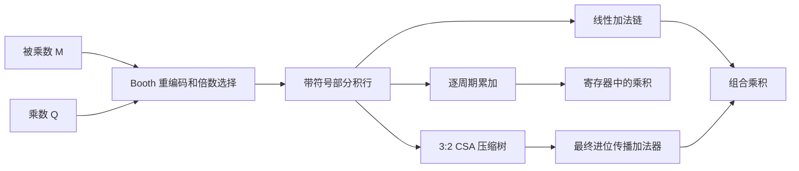

# 02 硬件架构与 RTL

## 1. 同一个功能，三种部分积求和方式



重编码回答“这一组取 `0, ±M, ±2M, ±3M, ±4M` 中哪一个”；求和网络回答“如何把所有行加起来”。这两个问题可以独立选择。例如 `booth_radix4_parallel` 和 `booth_radix4_csa` 使用同一个 `booth_radix4_pp`，只是后级不同。

## 2. `booth_radix2_iter.v`：经典 A/Q/Q-1 结构

该模块保存四项状态：

| 信号 | 宽度 | 作用 |
| --- | ---: | --- |
| `m_reg` | W+1 | 符号扩展的被乘数；保护最小负数取反 |
| `a_reg` | W+1 | 上半部分和保护位 |
| `q_reg` | W | 下半部分及待处理的乘数位 |
| `q_minus` | 1 | 上一次移出的乘数位，初始 0 |

`case ({q_reg[0],q_minus})` 对应 radix-2 编码表。`a_after_add` 是本轮加减结果；`shifted = $signed({a_after_add,q_reg,q_minus}) >>> 1` 做**整体算术移位**。最后从 `shifted[2*WIDTH:1]` 取 2W 位产物，丢弃保护位和历史位。`count` 从 0 开始，每个忙周期处理一位。

`$signed` 不可省：Verilog 的拼接表达式本身是无符号的；即使 `a_after_add` 已声明 `signed`，直接对拼接做 `>>>` 也可能变成补 0 的逻辑右移。

这个结构的计算通路只有一个 W+1 位加减器和一个移位布线网络，但要使用 W 个忙周期，适合愿意用周期换资源的场合。寄存器、复用器和控制也占资源，因此不能仅凭“一个加法器”断言总面积数值。

## 3. `booth_radix4_pp.v`：可复用部分积生成器

`y_ext = {必要的符号延拓,Q,1'b0}` 同时提供顶部符号延拓与 `q_-1=0`。每一组的 `code = y_ext[2*k+2 -: 3]`。`decode` 选 `0,±M,±2M`，然后 `selected <<< (2*k)` 得到**已对齐**的 `2W` 位行。输出 `rows[k*2W +: 2W]` 把这些行打包给下游。若 W 为奇数，`ROWS=(W+1)/2`，顶部仍能读到符号延拓位。

`M` 先扩展到 `2W` 位，再移位或取负。顺序很重要：W 位的最小负数 `-2^(W-1)` 不能在 W 位内取正；若先在 W 位取负再扩展，会得到错误结果。

## 4. `booth_radix4_iter.v`：一个 2W 位累加器

`start` 时锁存两个操作数、清零 `accumulator`，之后每忙周期由 `count` 选出当前重叠三位 `code`，用同一个 `decode` 生成一行 `selected_row` 并累加。处理完 `ceil(W/2)` 行后，把最终和写入 `product` 并脉冲输出 `done`。它是**逐行译码、逐行累加的 radix-4 实现**，与经典 A/Q 整体右移 radix-2 的状态机结构不同；两者重编码的数学含义一致。

这里复用一个倍数选择器和一个 2W 位累加器，代价是每次只处理一组。`booth_radix4_pp.v` 则一次生成所有行，专供两个并行结构使用。实际资源数量仍要以综合后的结果为准；动态分组选择与移位网络也需要硬件。

## 5. `booth_radix4_parallel.v`：并行行生成，线性求和

所有 `ROWS` 行在组合逻辑中同时生成。`running_sum[k+1]=running_sum[k]+row[k]` 是线性的加法链，清楚展示重编码怎样接求和，但会形成串行的进位传播路径。没有时钟端口，输入变化后经过组合传播输出稳定；**不能把它描述为一个时钟周期完成**，除非外部另加寄存器并完成时序收敛。

## 6. `booth_radix4_csa.v`：压缩到两行再相加

`csa_reduce.v` 每组三行 `a,b,c` 变成：

```text
sum   = a XOR b XOR c
carry = ((a AND b) OR (a AND c) OR (b AND c)) << 1
a + b + c = sum + carry                  (mod 2^2W)
```

3:2 压缩的每个比特位置只做局部逻辑，不在每一层把进位传播到最高位。递归层把行数不断缩到两行，`booth_radix4_csa.v` 才执行一次 `sum+carry`。这个代码是**按行分组的 CSA 树**，不是经过列高调度优化的 Wallace 或 Dadda 树。压缩层数比线性加法链更有利于缩短逻辑深度，但实际最大频率仍要综合和实现结果验证。[UCSB 讲义的 carry-save 章节](https://web.ece.ucsb.edu/Faculty/Parhami/pres_folder/f31-book-arith-pres-pt3.pdf)

例如 W=8 时 radix-4 有 4 行：本工程的递归压缩行数经过 `4→3→2`，再做最终一次全宽加法；线性求和则有 3 次依次依赖的全宽加法。这里说的是结构级路径，不是纳秒时延测量。

## 7. radix-8 线性与 CSA：固定编码，更换求和网络

`booth_radix8_pp.v` 用 `y_ext={必要的符号延拓,Q,1'b0}` 支持四位重叠分组。`decode` 从 `0,±M,±2M,±3M,±4M` 选择，`triple_m=(M<<1)+M` 需要一条额外加法通路。`booth_radix8_parallel.v` 用**线性加法链**求和；`booth_radix8_csa.v` 复用相同部分积行，改用与 radix-4 CSA 相同的 `csa_reduce`。这样可以分别观察改变 radix 与改变求和网络的影响，仍需在同一目标和约束下综合，才可做定量比较。

## 8. `booth_radix8_iter.v`：三位一组的复用架构

这个模块与 radix-4 迭代版采用相同的 `start/busy/done` 合同，但每个忙周期处理乘数的 **3 位**，需要 `ceil(W/3)` 个忙上升沿。顶部分组使用 `PAD=(3-W%3)%3` 个符号延拓位；`code=y_ext[3*count+3 -: 4]` 选择当前重叠四位。`triple_m=(M<<1)+M` 生成 `3M`，单个 `decode` 在每拍复用，`selected_row` 左移 `3*count` 后进入同一个 2W 位累加器。

与 radix-4 迭代版相比，它减少忙周期数，却扩大了译码和倍数生成通路。W=8 时三种迭代版依次需要 8、4、3 个忙周期；**启动边沿另算一拍**，连续启动间隔分别为 9、5、4 拍。这样的周期差异是 RTL 可直接验证的，时钟频率和总面积则仍需综合。

## 9. radix-4 流水版：延迟与吞吐量分开看

`booth_radix4_pipe.v` 在第一个寄存器阶段锁存所有 radix-4 部分积行，随后在第二个阶段经 CSA 压缩、最终加法并锁存 `product`。若输入在上升沿 N 与 `in_valid=1` 一同采样，结果在下一上升沿 N+1 与 `out_valid=1` 一同出现。两级可同时处理不同交易，因此稳定运行时可**每时钟接收一组**，但单笔交易仍需跨过一个完整时钟间隔。`tb_pipeline.sv` 用背靠背输入和空拍验证标记与结果不乱序。这里没有 `ready`，上游必须在有 `in_valid` 的上升沿提供稳定输入。

## 10. 无符号封装为什么要零扩展

`booth_radix4_unsigned.v` 把每个 W 位无符号输入前面补一个 `0`，送入 `WIDTH=W+1` 的有符号 radix-4 CSA 核心。这样原本无符号的最大值 `2^W-1` 在核心里仍为正数。核心产生 `2(W+1)` 位结果；数学积最多需要 `2W` 位，因此输出取低 `2W` 位。它是**另一个已验证的接口**，不等于把原有 W 位有符号模块的端口声明直接改成 `unsigned`。

## 11. 接口、延迟与重启

- 所有 Booth 模块要求 `WIDTH>=2`；输入按 W 位两补码解释，输出为完整 `2W` 位有符号积。
- 三个迭代模块在时钟上升沿同步复位。`start && !busy` 时采样操作数；忙时 `start` 被忽略。完成时 `done` 拉高一个周期，`busy` 拉低，`product` 保持到下次完成或复位。
- 从接收 `start` 的上升沿算起，radix-2 在第 W 个后续忙上升沿给出 `done`；radix-4 在第 `ceil(W/2)` 个、radix-8 在第 `ceil(W/3)` 个后续忙上升沿给出 `done`。若 `start` 一直为高，空闲后的下一上升沿会再次启动；通常应给单周期启动脉冲。
- 四个并行 Booth 模块、无符号封装及 `mul_inferred` 是组合模块，无 `done`；其传播时间由综合后的硬件决定。流水版使用 `in_valid/out_valid`，每拍可接收一组，复位清空在途交易。

## 12. 基线为何仍值得保留

`mul_inferred.v` 仅写 `assign product = multiplicand * multiplier`。在 FPGA 上综合器可能优先使用硬 DSP 乘法资源；在 ASIC 上会按库和约束映射成具体逻辑。它给出**功能参考**和日后 PPA 实验的基线，但不预设综合器内部一定使用或不使用 Booth。纯 RTL 行数也不能直接换算成门数。
