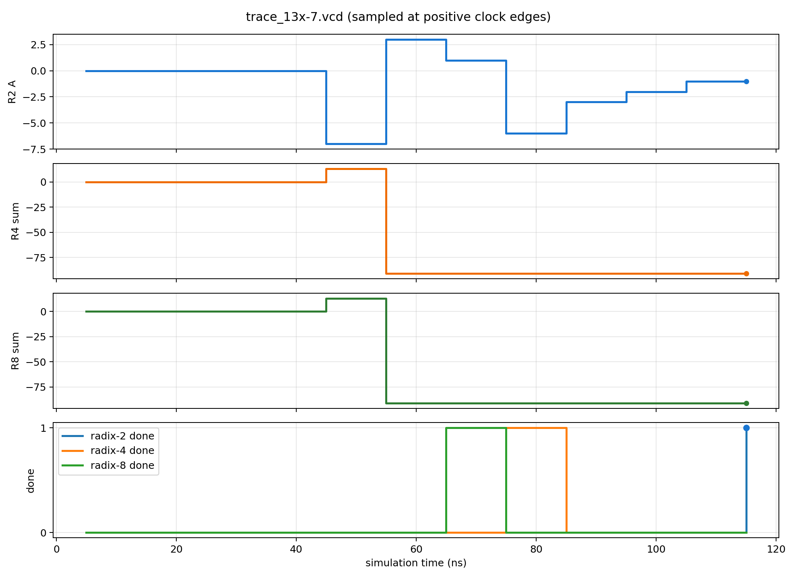
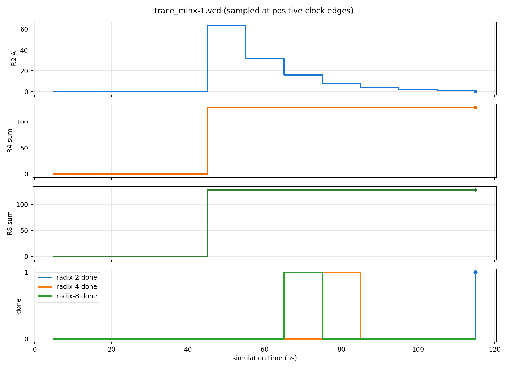
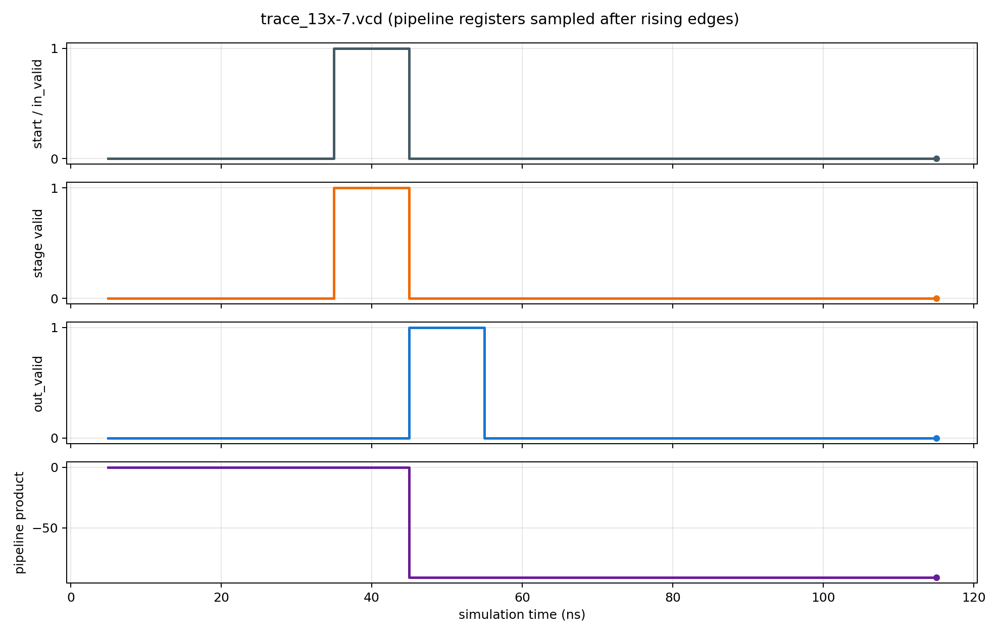

# 03 仿真与波形

## 1. 一键验证到底检查了什么

`bash scripts/run.sh` 用 `iverilog -g2012` 分别编译每种位宽的 testbench，然后用 `vvp` 执行。`tb_equivalence.sv` 对三个迭代模块等 `done`，对流水模块等 `out_valid`，对四个 Booth 组合模块和 `mul_inferred` 等组合逻辑稳定后检查。参考值由 testbench 的 `$signed(a)*$signed(b)` 生成；所有有符号实现与它对照。`tb_unsigned.sv` 使用无符号参考值。

测试矩阵：

| W | 方法 | 输入对数 |
| ---: | --- | ---: |
| 2 | 9 个边界例 + 全部 16 对 | 25 |
| 3 | 9 个边界例 + 全部 64 对 | 73 |
| 4 | 9 个边界例 + 全部 256 对 | 265 |
| 5 | 9 个边界例 + 全部 1024 对 | 1033 |
| 6 | 9 个边界例 + 全部 4096 对 | 4105 |
| 7 | 9 个边界例 + 全部 16384 对 | 16393 |
| 8、9、12、16、24、31、32 | 各 9 个边界例 + 500 对伪随机输入 | 各 509 |

边界例覆盖 0、±1、最小负数、最大正数及最小负数平方。随机测试增加覆盖范围，但不能代替形式验证；大位宽也没有穷举。

无符号封装在 W=2–7 各做 3 个边界例加全部输入对，在 W=8、9、12、16、24、31、32 各做 3 个边界例加 500 对随机输入。W=9 与 W=31 补充检查较宽奇数位的顶部符号延拓和分组。`tb_control.sv` 测迭代接口，`tb_pipeline.sv` 测流水版的连续输入、空拍和复位取消。

## 2. 生成自己的轨迹

默认示例：

```bash
bash scripts/run.sh
python3 scripts/vcd_report.py
```

默认 VCD 是 `build/trace_13x-7.vcd`，报告是 `build/trace_13x-7_cycles.csv`、`build/trace_13x-7_waveform.png` 和 `build/trace_13x-7_pipeline.png`。图像由**真实 VCD**生成，不是手绘的预期波形。

自选 8 位有符号例子，例如 `-128 × -1`：

```bash
iverilog -g2012 -s tb_trace -o build/trace.vvp rtl/*.v tb/tb_trace.sv
vvp build/trace.vvp +A=-128 +B=-1 +VCD=build/trace_min.vcd
python3 scripts/vcd_report.py build/trace_min.vcd
```

`tb_trace.sv` 还会在终端逐周期打印状态。另一个位宽可在编译命令中加入 `-Ptb_trace.W=5`，输入必须落在对应 W 位有符号范围，否则 testbench 会报错。

## 3. 读 `13 × (-7)` 的波形



图中每个数据点取自 VCD 的上升沿结束后状态。默认时钟周期为 10 ns：

| 时间 | radix-2 `A,Q,Q-1` | radix-4 累加器 | radix-8 累加器 | 解释 |
| ---: | --- | ---: | ---: | --- |
| 35 ns | `0,F9,0` | 0 | 0 | 接收 `start`，载入操作数 |
| 45 ns | `-7,FC,1` | 13 | 13 | 第一次 radix-2 `10 → -M`；两个高 radix 版本累加首行 `+13` |
| 55 ns | `3,7E,0` | -91 | -91 | radix-2 `01 → +M`；两个高 radix 版本累加第二行 |
| 65 ns | `1,BF,0` | -91 | -91，`done=1` | radix-8 第三行处理结束 |
| 75 ns | `-6,5F,1` | -91，`done=1` | -91 | radix-4 第四行处理结束 |
| 115 ns | `-1,A5,1`，`done=1` | -91 | -91 | radix-2 第八轮结束，输出 `0xFFA5` |

不同 `done` 时刻说明三种迭代算法忙周期数不同；并行结构没有 `done`，输入稳定后就得到组合结果。图中的 `A` 是 radix-2 的**中间状态**，不能当成最终乘积；最终要拼接 `A` 的低 W 位和 `Q`。

最右侧圆点是 VCD 最后一个上升沿的实际采样值。仿真在该拍后不久结束，所以图不把最后一次 `done=1` 擅自延长成一整段未记录的波形；完成脉冲宽度应结合 RTL 和继续仿真的轨迹判断。

### 极值例子：`-128 × -1`



这是 `vvp build/trace.vvp +A=-128 +B=-1 +VCD=build/trace_minx-1.vcd` 生成的第二条真实轨迹。radix-4 迭代版在第一个忙上升沿就累加 `+128`，第四个忙上升沿输出 `128`；radix-2 的 `A` 依次经过 `64,32,16,8,4,2,1,0`，末态 `Q=0x80`，故 `{A[7:0],Q}=0x0080=128`。这条轨迹能直观看到：中间状态未必像最终乘积，且最小负数的负倍数必须在足够宽的数据通路中表示。配套逐周期表是 `build/trace_minx-1_cycles.csv`，另可查看[同一极值输入的流水时序图](../assets/pipeline_minx-1.png)。

### 同一交易的流水时序



图中所有值均在上升沿更新完成后采样。35 ns 上升沿同时看到入口 `in_valid=1` 和内部 `valid_reg=1`，说明部分积已被第一阶段接收；此时 `out_valid=0`。45 ns 上升沿 `out_valid=1`，`product=-91`；入口 `in_valid` 和 `valid_reg` 已回到 0。这个实例只有一笔交易，**每拍吞吐**还由 `tb_pipeline.sv` 的连续 valid 测试验证。图中同一采样时刻的入口电平与内部寄存器电平有不同的时间语义：前者是在该边沿被采样的输入，后者是该边沿更新后的状态。

## 4. 建议观察的信号

VCD 用 `$dumpvars(0,tb_trace)` 记录层级内部信号。图形查看器或其他 VCD 分析工具可重点查看：

| 信号 | 应看到什么 |
| --- | --- |
| `r2.q_reg[0]`, `r2.q_minus` | radix-2 的 `00/01/10/11` 决策 |
| `r2.a_after_add`, `r2.shifted` | 本轮加减之后、整体算术右移之后 |
| `r2.a_reg`, `r2.q_reg`, `r2.count` | 每轮状态与轮数 |
| `r4i.code`, `r4i.selected_row` | radix-4 的当前三位分组与当轮行 |
| `r4i.accumulator`, `r4i.count` | 逐行累加过程 |
| `r8i.code`, `r8i.triple_m`, `r8i.selected_row` | radix-8 迭代版的四位分组、`3M` 和当轮行 |
| `r8i.accumulator`, `r8i.count` | radix-8 的逐行累加过程 |
| `csa.tree.sum`, `csa.tree.carry` | 压缩树的两行输出；两者和为最终乘积 |
| `r8.pp.g_row[*].code`, `r8.pp.g_row[*].selected` | radix-8 的四位编码和倍数 |
| `pipe_r4.valid_reg`, `pipe_r4.out_valid` | 入口标记到出口标记的一个时钟间隔 |

`code` 在 `busy=0` 且索引超过末组时被钳为 `000`（radix-4）或 `0000`（radix-8），使 `selected_row` 为 0，避免用无效索引显示 `X`。若波形中出现 `X`，先检查复位、输入初始化、数组索引与算术位宽；`X` 不是负数或 Booth 的特殊编码。

## 5. 波形工具与插件的角色

本工程已能用 Icarus Verilog **编译、仿真并生成 VCD**，`vcd_report.py` 可直接把 VCD 变成周期表和 PNG。波形分析插件只消费已生成的波形；它不能代替 RTL 编译和仿真。当前会话未检测到可调用的 `wave-mcp` 工具，因此这里用可复现的本地 VCD 流程。若以后在当前 Codex 客户端正确接入支持 VCD 的插件，可把 `build/trace_13x-7.vcd` 和 `rtl/` 交给插件做时间点查询；先确认插件实际运行的主机能访问这些路径。无需为了阅读本工程强制安装波形 GUI。

## 6. 常见错误的波形特征

- 把 `01`/`10` 的加减方向写反：连续 1 的边界处马上与预期分叉。
- 拼接后忘记 `$signed`：负数用逻辑右移，`A` 高位补 0；负乘数测试大面积失败。
- 对 W 位最小负数先取反：`MIN × -1` 测试失败，其他普通数可能通过。
- radix-4 奇数位宽顶部未符号扩展：W=3、5 的负乘数出错。
- CSA 忘记 `carry << 1`：压缩树输出与线性加法链不同。
