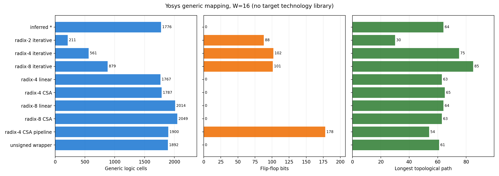
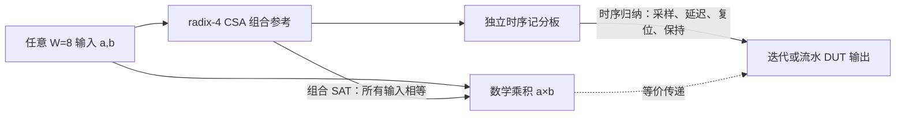

# 06 可复现的综合与形式验证

这一章回答“RTL 写法不同，通用综合后发生了什么”，并明确数值能说明到哪里。原始数据由 `scripts/synth_compare.py` 生成在 `build/synth/summary.csv`；每个组合还保留 Yosys 日志和 JSON 网表。

## 1. 复现命令

```bash
bash scripts/run.sh
bash scripts/lint.sh
bash scripts/formal_check.sh
bash scripts/formal_check.sh --deep
bash scripts/formal_check.sh --induct-r2-w8
python3 scripts/synth_compare.py
```

本次运行环境：macOS，Icarus Verilog 13.0、Verilator 5.048、Python 3.14.7、matplotlib 3.10.9、Yosys 0.70+post。`--deep` 包含 W=8 的组合证明、有限步时序证明，以及流水、radix-4 迭代版及 radix-8 迭代版的乘积归纳证明。`--induct-r2-w8` 单独复现耗时较长的 radix-2 乘积归纳证明。Yosys 的 `-timeout` 作用于 SAT 求解过程；归纳需要重复求解，整项检查可能超过这个秒数。超时应记录为“未证成”，不能记为功能错误，也不能记为通过。

`synth_compare.py` 对每个顶层与位宽单独加载该顶层所需的 RTL 依赖，再执行 `read_verilog → chparam → synth -top ... -flatten → write_json → ltp -noff`。`synth` 使用 Yosys 默认 ABC 通用门映射，没有设置 FPGA 器件或 ASIC 标准单元库。表中“逻辑单元”是 JSON 网表中的通用组合 cell 数，排除 `$scopeinfo` 和 DFF；“FF”是 DFF bit 数；“拓扑长度”是 `ltp -noff` 报告的最长路径长度。`ltp` 需要扁平化设计，`-noff` 排除 FF cell。[Yosys 0.70 `ltp` 文档](https://yosyshq.readthedocs.io/projects/yosys/en/v0.70/cmd/index_passes_status.html)

## 2. 同一通用综合流程下的结果

| 架构 | W=8 逻辑 | W=8 FF | W=8 拓扑长度 | W=16 逻辑 | W=16 FF | W=16 拓扑长度 |
| --- | ---: | ---: | ---: | ---: | ---: | ---: |
| `*` 推断基线 | 412 | 0 | 30 | 1776 | 0 | 64 |
| radix-2 迭代 | 123 | 47 | 20 | 211 | 88 | 30 |
| radix-4 迭代 | 267 | 53 | 42 | 561 | 102 | 75 |
| radix-8 迭代 | 460 | 52 | 49 | 879 | 101 | 85 |
| radix-4 线性 | 418 | 0 | 32 | 1767 | 0 | 63 |
| radix-4 CSA | 423 | 0 | 32 | 1787 | 0 | 65 |
| radix-8 线性 | 484 | 0 | 34 | 2014 | 0 | 64 |
| radix-8 CSA | 486 | 0 | 34 | 2049 | 0 | 63 |
| radix-4 CSA 流水 | 455 | 58 | 25 | 1900 | 178 | 54 |
| 无符号 radix-4 封装 | 472 | 0 | 33 | 1892 | 0 | 61 |



图片由 `python3 scripts/plot_synth.py --width 16` 直接从 `build/synth/summary.csv` 生成；三个面板的横轴量纲不同，不应把柱长跨面板相加或比较。

这些数据是**一次特定通用映射实验**。它们不是晶体管数、硅面积、LUT 数、DSP 数、瓦数或纳秒。不同基本门的面积和延迟不同，拓扑长度也不考虑实际负载、布线及单元延迟。修改 Yosys/ABC 版本、优化选项、技术库或约束会改变数字。

几个值得从实验中读出的事实：

- radix-2 迭代的组合 cell 数较少，但 W=8/16 分别要 8/16 个忙周期。不能只比较单次组合路径长度。
- radix-4 与 radix-8 迭代 RTL 复用译码器，却仍包含动态分组选择、动态左移和 2W 位累加器；在这次映射中，组合路径长度甚至高于相应并行实现。radix-8 迭代版忙周期更少，但译码与 `3M` 生成增加了通用逻辑和拓扑长度。因此“迭代”或“高基数”都不等于“任何指标都更好”。
- radix-4 CSA 在这次 ABC 映射后没有比线性链显著减少通用 cell 或拓扑长度。CSA 的局部进位性质仍成立，但末级进位传播、译码与综合器优化影响最终网表。不能由理论图推断它在所有位宽与工具下必定更快。
- radix-8 行数少于 radix-4，`3M` 生成与复杂译码增加了组合逻辑；本次 W=8/16 的映射没有呈现门数优势。这个观察仅限当前配置。
- 流水版用了更多 FF，但缩短了**寄存器边界内**的拓扑长度，并可每拍接收一组输入。能否达到目标时钟仍须真实时序分析。

无符号封装内部是 W+1 位有符号核心，表中的无符号行与 W 位有符号基线不是相同输入合同，不能据此判定两者谁更省资源。

## 3. 形式验证覆盖什么

`scripts/check_math.py` 独立于 RTL，穷举 W=2–16 的 131,068 个乘数位模式，验证 radix-2、radix-4、radix-8 的带符号数字加权和均恢复同一个两补码整数。这个检查证明的是**重编码公式实现**，不是时钟接口。

`formal/comb_equiv.sv` 是组合乘法器的 SAT miter：无约束的输入 `a,b`，参考为完整宽度的 `a*b`，断言每个实现结果相同。`bash scripts/formal_check.sh` 验证 W=4 的四个有符号组合架构与无符号封装；`--deep` 将它们拆成单架构，在 W=8 逐项证明。每项成功意味着该固定位宽下**所有输入位模式**满足断言，而不只是随机样本。[Yosys 0.70 `sat` 与 `chformal` 文档](https://yosyshq.readthedocs.io/projects/yosys/en/v0.70/cmd/index_formal.html)

`formal/iter_equiv.sv` 与 `formal/pipe_equiv.sv` 用独立记分板检查时序：参考乘积在输入被接收的时钟边沿计算，随后验证迭代模块的 `busy/done/product`，以及流水模块的 `out_valid/product`。默认运行对 W=4 分别展开 radix-2 迭代 12 步、radix-4 与 radix-8 迭代各 10 步、流水 10 步；`--deep` 另对 W=5 做 14/10/10/10 步。在这些检查中，`rst`、`start`、`in_valid` 和输入数据在每一步都不受约束，因此有限步验证包含忙时再次启动、背靠背输入、气泡、复位取消以及结果保持。`-set-init-zero` 把设计和记分板的寄存器初态都固定为零；这是**从该初态出发的有限步证明**，不是任意初态或无限时间的归纳证明。四个 W=4 设计还有可达性检查，均能找到 `product=-15` 且 `done` 或 `out_valid` 为 1 的轨迹，避免只验证从未完成的空路径。

对 W=8，`--deep` 还运行聚焦的一笔交易证明：把 `rst` 在所有展开步骤固定为 0，在第一步固定 `start=1` 或 `in_valid=1`；流水版第二、三步固定 `in_valid=0`。三个迭代架构分别展开 10、7、6 步，流水版展开 4 步，仍对第一步的全部 8 位操作数位模式进行符号验证。后续输入数据没有固定；迭代版忙时 `start` 也没有固定。四个证明均通过，另有 `product=-91` 且 `done/out_valid=1` 的可达轨迹。这个聚焦检查证明给定控制条件下的一笔交易与输出时点，不能替代 W=4/5 的任意复位和任意 valid 序列检查。

`formal/control_equiv.sv` 把**接口控制**从复杂的乘积数据通路中分离出来：对迭代版检查 `busy/done` 与接受启动、忙周期数、复位取消和完成脉冲一致；对流水版检查 `out_valid` 与输入标记的两个寄存器阶段一致。操作数、`rst`、`start`、`in_valid` 逐步任意变化。默认对 W=8 展开 22 步；`--deep` 对 W=32 展开 70 步，四种设计均通过。W=32 还分别找到实际 `done/out_valid=1` 的可达轨迹。

控制性质另用 `sat -tempinduct` 做**基例加归纳步骤**，W=8、W=32 的四个设计均证明成功。归纳长度分别为 radix-2 的 16/64 步、radix-4 的 8/32 步、radix-8 的 4/16 步、流水控制的 2/2 步。与上面的有限展开不同，归纳结果证明：从设定的零寄存器初态出发，对所有后续时钟和所有已定义的输入位模式，所断言的控制输出关系都成立。它没有证明任意内部初态；W=32 的数据结果仍只由仿真覆盖。[Yosys `sat -tempinduct` 文档](https://yosyshq.readthedocs.io/projects/yosys/en/v0.70/cmd/index_formal.html)

### W=8 全时序乘积证明的组合方法

直接以 `a*b` 为时序记分板参考的 W=8 任意控制序列检查曾在 60 秒上限超时。改用两个可独立验证的命题后，四种时序架构都完成了乘积与控制的归纳证明：



1. 组合 miter `formal/comb_equiv.sv` 的 `one_equiv ARCH=1` 已在 W=8 对**全部** 8 位有符号输入证明 `booth_radix4_csa(a,b) == a*b`；日志为 `build/formal/r4_csa_w8.log`。
2. `formal/iter_equiv.sv` 和 `formal/pipe_equiv.sv` 取 `REFERENCE=1`，在输入被接收时把同一个 radix-4 CSA 的结果存入独立记分板。该记分板仍独立于被测迭代或流水电路，断言 `busy/done/out_valid/product` 的周期关系。流水、radix-4 迭代、radix-8 迭代、radix-2 迭代分别在归纳长度 2、9、5、17 成功；对应日志为 `pipe_w8_composed_induct.log`、`iter_r4_w8_composed_induct.log`、`iter_r8_w8_composed_induct.log`、`iter_r2_w8_composed_induct.log`。
3. 由于第一项对所有输入恒成立，第二项记分板在每次接收时采样的值就是数学乘积。因此从零寄存器初态出发，对 W=8 全部后续有定义的操作数、复位、启动、valid 序列，四个模块的乘积和所断言的控制关系均成立。证明不覆盖任意内部初态，也不自动推广到其他位宽。

`--deep` 自动跑流水、radix-4 和 radix-8 的三种较快归纳检查；`--induct-r2-w8` 跑 radix-2 迭代，并重做所依赖的组合 miter。两种命令都先跑默认 W=4/W=8 控制检查。曾尝试把 W=8 四个组合架构合进一个 SAT 问题，30 秒内超时；拆成单架构后均成功。另以同一 `one_equiv ARCH=1` miter 尝试 W=12 radix-4 CSA，`sat -timeout 300` 返回 `proof did time out`（日志 `build/formal/r4_csa_w12.log`），因此 W=12 **没有**逐位 SAT 等价结论；它的功能证据来自边界和随机仿真。`tb_equivalence.sv`、`tb_control.sv`、`tb_pipeline.sv` 仍提供较大位宽的仿真覆盖。超出 W=8 的组合宽度尚无逐位 SAT 证明。

## 4. 面向真实目标的下一步

若要判断能否替代某个实际乘法器，需要固定目标 FPGA 或工艺库、乘法输入/输出寄存器、时钟约束、DSP 使用策略、流水级数和功耗估计条件，然后分别综合、布局布线并报告面积与时序。组合架构和迭代架构还应同时报告结果延迟与单位时间吞吐量；否则比较没有明确意义。
